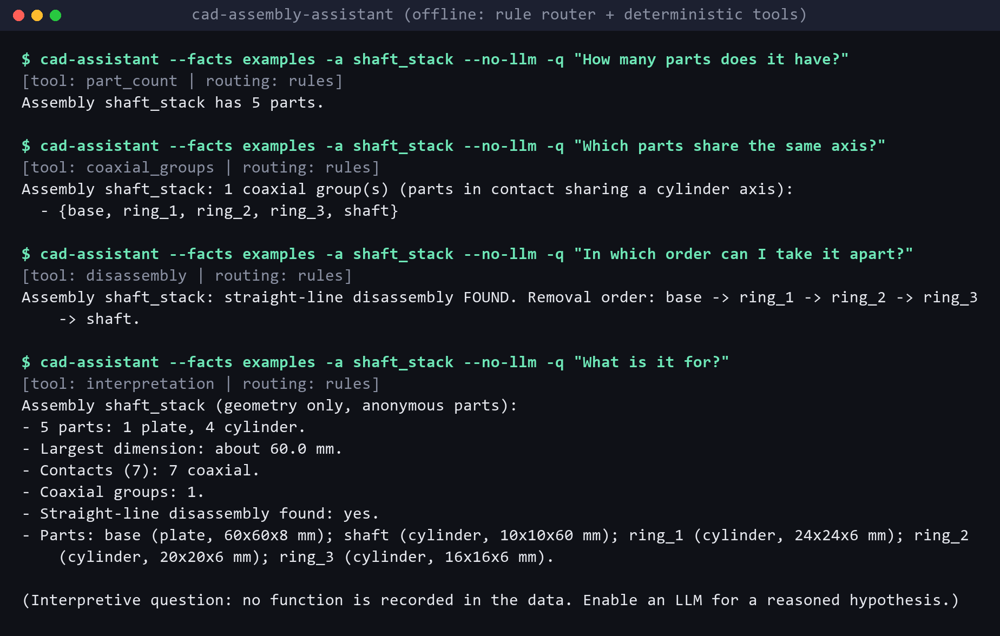

# cad-assembly-assistant

**Status: prototype.** Ask questions about a mechanical assembly in plain English, for example:
- "how many parts?"
- "which parts share an axis?"
- "in which order can I take it apart?"

Every answer comes from **deterministic geometric facts**, never from what a language model believes.

**Principle: the geometry decides, the language model only phrases.**

```
question ──► ROUTING (keyword rules, or optional LLM) ──► deterministic TOOL ──► answer
                                                              │                 (tool text, or
                                                     facts of the assembly       LLM rephrasing
                                                                                  of that text)
```

Without an API key everything works offline: the rule router picks the tool, and the answer is the tool's own text.



*Real output of `cad-assistant` in offline mode, without any LLM, on the bundled `shaft_stack` example, rendered as an image. Each answer names the tool that produced it. The last question asks about function: with no LLM, the assistant gives the structural facts and says that no function is recorded.*

## Facts

An assembly is described by a small JSON *facts* file:
- parts: type, size, centre;
- contact graph, with `coaxial` contacts between parts that touch and share a cylinder axis;
- annotated joints, if any;
- verified exploded-view plan;
- straight-line disassembly order.

Facts are computed from a STEP file by [cad-exploded-view-verifier](https://github.com/ayoub-elkhader/cad-exploded-view-verifier):
- contacts are the pairs within the verifier tolerance in the assembled state;
- the disassembly order comes from its sequential removal test;
- part types (`box`, `plate`, `cylinder`) are a coarse label from the bounding box and the share of cylindrical surface area.

Facts can also be computed from the two public datasets used in the thesis (see [DATASETS.md](https://github.com/ayoub-elkhader/cad-exploded-view-verifier/blob/main/DATASETS.md) in the verifier repository):
- `--fusion` for a Fusion 360 Gallery `assembly.json`; the joints annotated in the file are kept;
- `--automate` for an AutoMate assembly; its mates become annotated joints.

`examples/` contains:
- the facts of three synthetic assemblies generated from OCCT primitives (`pin_in_plate`, `shaft_stack`, `caged_cube`). `scripts/build_examples.py` regenerates them, and a test checks that they are up to date;
- the facts of one real AutoMate assembly (`automate_d0582033`: 8 parts, 14 mates; data CC0, see `examples/README.md`).

## Tools

`summary`, `part_count`, `bom`, `part_info`, `contact_graph`, `neighbors`, `coaxial_groups`, `joints`, `disassembly`, `assembly_order`, `evidence_bundle`, `list_assemblies`.

Each tool returns structured data plus a short text. Questions about *function* ("what is it for?") get the structural facts. With an LLM, they also get a hypothesis clearly labelled as such.

## Installation

```bash
pip install -e .                 # router, tools, bundled examples (pure Python)
pip install -e .[llm]            # + optional LLM layer (any OpenAI-compatible endpoint)
conda env create -f environment.yml   # + facts from STEP files (pythonocc-core, conda-forge)
```

The LLM layer reads `LLM_API_KEY`, `LLM_BASE_URL` and `LLM_MODEL` from the environment (see `.env.example`). Calls to a hosted endpoint may be billed.

## Usage

```bash
cad-assistant --facts examples -a shaft_stack -q "In which order can I take it apart?" --no-llm
# [tool: disassembly | routing: rules]
# Assembly shaft_stack: straight-line disassembly FOUND. Removal order: base -> ring_1 -> ring_2 -> ring_3 -> shaft.

cad-assistant --step my_assembly.step --save-facts my_assembly.json   # then interactive questions
cad-assistant --fusion <root>/<assembly_id>/assembly.json
cad-assistant --automate <assemblies>/<assembly_id>.json --step-dir <step_folder>
```

## Results (offline, rule router)

```bash
python -m cad_assistant.evaluate --facts examples
```

On the 4 bundled assemblies, with 10 questions each:
- routing: **40/40**, the expected tool was chosen;
- grounding: **22/22**, the answer contains the expected fact.

This measures consistency, not robustness. The questions were written together with the keyword rules, and the router has not been tested on phrasings from other users. The LLM router has not been evaluated in this repository.

## Tests

```bash
pytest
```

25 tests pass locally (Windows 10, Python 3.10):
- pure Python: router, tools, refusal of unknown parts and tools, interpretation path offline, JSON extraction, CLI, evaluation;
- with pythonocc-core: the example facts match a fresh computation, and facts from a STEP file and from small files in the Fusion and AutoMate formats (joint and mate types).

CI runs the pure-Python tests on Python 3.10–3.12, and the geometry tests in a conda-forge job.

## Limitations

- **English keyword router.** Unusual phrasings fall back to the summary.
- **Joints are not inferred from geometry.** The `joints` tool only reports joints present in the data: Fusion joints and AutoMate mates. Facts computed from a plain STEP file have none.
- **Coarse labels.** "Coaxial" means "in contact and sharing a cylinder axis". Part types are approximate.
- **Mechanical simplifications.** The disassembly order inherits the limits of the verifier: rigid straight-line motions, discrete checks. The removal order is one valid order for that test, not necessarily the one a technician would choose (in `shaft_stack`, the base plate comes off first along its explosion direction).
- **LLM phrasing is not checked.** When enabled, the LLM's rephrasing is not verified against the facts. The raw tool text is always available in the result (`evidence`).

## License

MIT, see [LICENSE](LICENSE).
